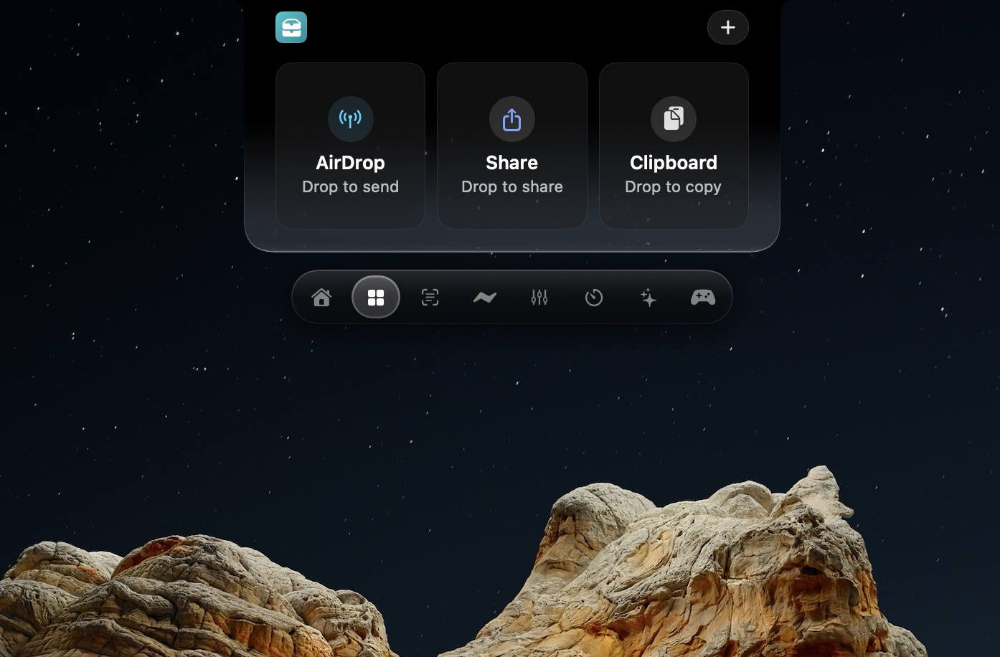

# Zenith
### Mac reimagined. Dynamic Island for Mac.

**1.3.1 · Free public beta · Apple silicon · macOS 26+**

[**Download Zenith ↓**](https://github.com/techgamewithharsh-dot/zenith-dynamic-notch/releases/latest/download/Zenith.dmg) · [Explore the website](https://techgamewithharsh-dot.github.io/zenith-dynamic-notch/) · [Release notes](https://github.com/techgamewithharsh-dot/zenith-dynamic-notch/releases/tag/v1.3.1)

Developer ID signed by Harsh Paun and Apple-notarized.

## A little closer to everything

Zenith brings music, smart files, focus and personal touches to your Mac’s notch in a shared liquid glass interface. Floating presentations also work without a physical notch.

| Make it yours | What’s inside |
| --- | --- |
| Music & sound | Playback controls, per-app volume, visualizers and saved Apple Music EQ profiles for your headphones and speakers. |
| Keyboard character | Four sound profiles, release sounds, depth and stereo tuning, with interactive previews in Settings and onboarding. |
| Files & clipboard | Stage files, share or AirDrop, choose ZIP or direct folder sharing, convert batches and build PDFs from images. |
| Focus & everyday tools | Timers, notes with pinning, separate tasks, teleprompter, calendar and launcher. |
| Gaming | Game Mode with pinned performance graphs, Minecraft arrivals, direct Play Together and chat, supported launch capsules and save checkpoints. |
| Personalization | Clock styling, still-image wallpaper depth, lock-screen music and optional visual extras. |

[Complete feature guide →](FEATURES.md) · [Try the keyboard demo →](https://techgamewithharsh-dot.github.io/zenith-dynamic-notch/#keyboard-demo)

## Install

1. [Download Zenith.dmg](https://github.com/techgamewithharsh-dot/zenith-dynamic-notch/releases/latest/download/Zenith.dmg).
2. Open it and drag Zenith to Applications.
3. Open Zenith and follow onboarding for macOS permissions.

The current DMG is approximately **388 MB**. It requires **Apple silicon and macOS 26 or later**. The release includes SHA-256 checksums.

## Updates that finish installing

Zenith 1.3.1 includes a separate, signed **Zenith Updater**. After downloading and verifying an update, it can finish installation after Zenith closes. It replaces the app atomically and keeps the previous app until the new version launches. Settings stay in place. Automatic checks run at launch and periodically; manual **Check for Updates** remains in Settings.

### Already downloaded an update, but nothing installed?

[**Download Zenith Updater ↓**](https://github.com/techgamewithharsh-dot/zenith-dynamic-notch/releases/latest/download/Zenith-Updater.zip), unzip it, and open **Zenith Updater.app**. It fetches the latest signed release and installs it. No background daemon is needed.

Keep Zenith online and in a writable Applications folder. The 1.3.1 release uses a stable/latest tag for older stable-only checkers.

## What’s new in 1.3.1

- **ProMotion 120Hz SpringBoard Paging**: Rebuilt Zenith Launcher trackpad swipe navigation with continuous Apple SpringBoard physics (`response: 0.38, dampingRatio: 0.86`), zero micro-jitter, and seamless subpixel velocity tracking.
- **Mandatory Seamless Auto-Updater**: Zero-hassle background updater guarantees critical security, feature, and stability updates automatically.
- **Hardened Gatekeeper & Developer ID Security**: Hardened runtime, Developer ID codesigned, Apple notarized, and stapled. Full binary scrubbing with zero machine path leakage and sealed encrypted asset vault.
- **Enhanced Liquid Glass UI**: Refined physics and luminescent edge reflections across all panels.

[Full release notes and checksums →](https://github.com/techgamewithharsh-dot/zenith-dynamic-notch/releases/tag/v1.3.1)

## What was new in 1.3.0

- Saved device-specific Apple Music EQ, using Music’s official Equalizer controls.
- Live keyboard previews and a user-paced onboarding Highlights chapter.
- Rebuilt Minecraft portal arrival, corrected sword grip and wider chase spacing.
- Reduced redundant page-switch layout work and consistent pin behavior.
- A notarized standalone updater, also attached to this release for recovery.

[1.3.0 release notes →](https://github.com/techgamewithharsh-dot/zenith-dynamic-notch/releases/tag/v1.3.0)

## Compatibility & beta scope

Integrations depend on compatible installed apps, hardware and macOS permissions. Music EQ needs Accessibility and Music; unsaved devices leave the EQ unchanged. Direct play depends on the players’ networks. Game capsules and save tools need supported configurations. Camera-based recognition is experimental and is not Apple Face ID. Live/video wallpaper depth is disabled; still-image depth remains available.

[Read beta and compatibility notes →](BETA.md)

## More from Harsh Paun

| App | Bring more to your devices |
| --- | --- |
| [Cinematic Player](https://apps.apple.com/us/app/cinematic-player/id6763082533) | Movies, subtitles and a media library for iPhone and iPad. |
| [AirSend TV](https://apps.apple.com/us/app/airsend-tv-file-transfer/id6763094307) | Send personal media to Apple TV over local Wi-Fi. |
| [Dual Monitor For Mac](https://apps.apple.com/us/app/dual-monitor-for-mac/id6794083960) | Use an iPhone or iPad as another display for your Mac. |

[Explore their actual interfaces →](https://techgamewithharsh-dot.github.io/zenith-dynamic-notch/#more-apps)

## Feedback & ownership

Report reproducible problems in [Issues](https://github.com/techgamewithharsh-dot/zenith-dynamic-notch/issues), with app version, macOS version and Mac model. Remove personal information from attachments.

This repository is the official public showcase. The application source and internal assets remain private. © 2026 Harsh Paun. All rights reserved. See [NOTICE.md](NOTICE.md).

Zenith is independent and is not affiliated with or endorsed by Apple, Minecraft, Microsoft, CodeWeavers or other named third parties. Their trademarks belong to their owners.
