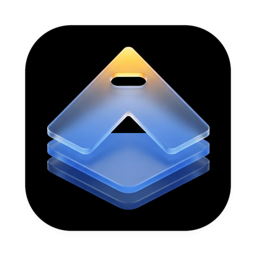
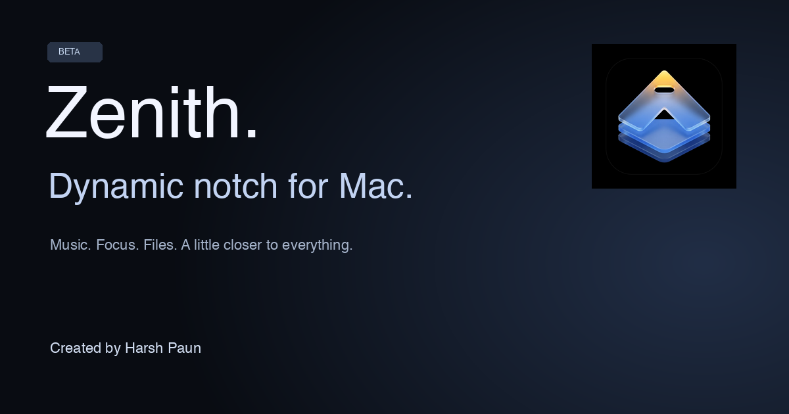

# Zenith — Dynamic Notch for Mac

### An independent Mac app by **Harsh Paun**

**BETA** · macOS 26+ · Apple silicon · Proprietary application

Music. Focus. Files. A little closer to everything.

[**Explore the website ↗**](https://techgamewithharsh-dot.github.io/zenith-dynamic-notch/) · [Every feature](FEATURES.md) · [Beta status](BETA.md) · [About Harsh Paun](HARSH-PAUN.md)

## Your Mac, a little more alive

**Zenith by Harsh Paun** brings music controls, focus tools, a file shelf and personal touches to the space around your Mac’s notch. Its unified liquid glass design also supports floating island presentations on compatible displays.

This is the **official public product showcase**. Zenith’s application source code, internal assets and implementation details are private and are not included in this repository.

## Explore Zenith

| Experience | What you can do |
| --- | --- |
| Music & sound | Now Playing, playback controls, available lyrics, visualizers and output selection. |
| Focus & productivity | Focus/break timers, teleprompter, calendar, tasks, notes, Shortcuts and webcam mirror. |
| Files & text | File shelf, sharing, download activity and DropClip text utilities. |
| Thunderstorm | Find installed apps and Zenith actions; launch saved Raycast command links. |
| Connected activities | Experimental notification, reply, call and coding-agent panels. |
| Game mode | Game-session controls, CPU/GPU graphs and supported device metrics. |
| Personalization | Lock-screen canvas, clock editor, widgets, pets and experimental 3D lid effects. |
| Power & preferences | Battery information, charging alerts, supported charge management and permission controls. |

**[Read all 66 feature descriptions →](FEATURES.md)** — includes availability labels and current limitations.

## Beta availability

Zenith is **in beta**. [Download the public beta](https://github.com/techgamewithharsh-dot/zenith-dynamic-notch/releases/tag/beta-2026-10-11) from GitHub Releases. Open Zenith.dmg and move Zenith to Applications.

- Current target: **macOS 26 or later, Apple silicon**.
- Hardware-specific features require compatible devices.
- App integrations require the relevant installed apps and macOS permissions.
- Some integrations are experimental; some designs are previews. See [beta notes](BETA.md).

## Created by Harsh Paun

Zenith is **Harsh Paun’s app**. Find Harsh under **[techgamewithharsh-dot](https://github.com/techgamewithharsh-dot)** on GitHub and **[Harsh Paun](https://apps.apple.com/us/developer/harsh-paun/id1895154152)** on the App Store.

### More apps by Harsh Paun

- **[Cinematic Player](https://apps.apple.com/us/app/cinematic-player/id6763082533)** — Video playback and a media library for iPhone and iPad.
- **[AirSend TV: File Transfer](https://apps.apple.com/us/app/airsend-tv-file-transfer/id6763094307)** — Send personal media to Apple TV and play it on the big screen.
- **[Dual Monitor For Mac](https://apps.apple.com/us/app/dual-monitor-for-mac/id6794083960)** — Use an iPhone or iPad as an additional display for your Mac.

## Feedback

Use [Issues](https://github.com/techgamewithharsh-dot/zenith-dynamic-notch/issues) for reproducible beta problems and feature suggestions. Remove private information from screenshots and do not post credentials or unfiltered logs.

## Ownership

© 2026 **Harsh Paun**. All rights reserved. Zenith is proprietary. Public visibility of this product showcase does not grant rights to copy, redistribute or rebrand the application or its branding. See [NOTICE.md](NOTICE.md).

Zenith is independent and is not affiliated with or endorsed by Apple, Raycast or other named third parties. Their trademarks belong to their respective owners.

## Try the music player

[Explore Zenith by Harsh Paun](https://techgamewithharsh-dot.github.io/zenith-dynamic-notch/#experience) — try a working liquid glass music player with original music, artwork, playback, seeking, shuffle and direct audio output switching where supported by the browser. Change the preview wallpaper and explore Zenith’s floating toolbar.

The website recreates Zenith’s interface for the browser. Full Mac features are available through the native app; [the public beta is available](https://github.com/techgamewithharsh-dot/zenith-dynamic-notch/releases/tag/beta-2026-10-11). Native application source and licensing remain private.
